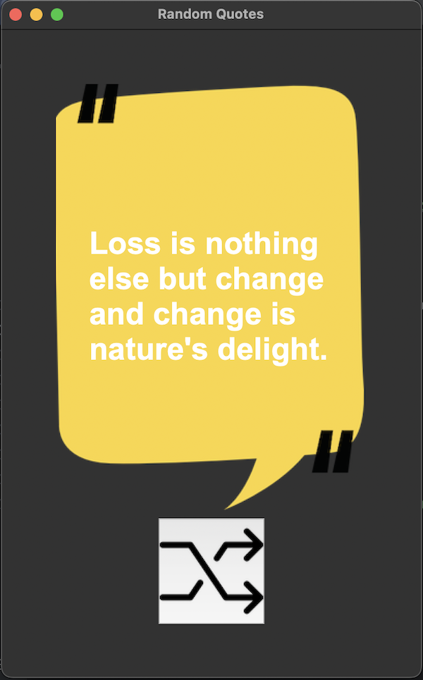

# 🧠 Random Quotes App

A simple Python GUI app built with Tkinter that fetches and displays random inspirational quotes using the [ZenQuotes API](https://zenquotes.io/).

## 📸 Preview

 <!-- Replace with actual screenshot if available -->

## 🛠 Features

- Click the button to fetch a new quote
- Uses `requests` to call a quote API
- Built with Python and Tkinter

## 🚀 How to Run

1. Clone the repository:
   ```bash
   git clone https://github.com/oudomm/100-days-of-python/tree/main/day_33/quotes-app
   cd quotes-app
2. Create and activate a virtual environment (optional but recommended):
    ```bash
   python -m venv .venv
   source .venv/bin/activate  # On Windows: .venv\Scripts\activate
3. Install dependencies:
   ```bash
   pip install -r requirements.txt
4. Run the app:
    ```bash
   python main.py

## 📦 Requirements

- Python 3.8+
- requests
- Tkinter (comes pre-installed with Python)

    You can install the required Python package with:
     ```bash
   python main.py

## 📡 API Used
- [ZenQuotes API](https://zenquotes.io/)

## ✏️ Customization Ideas
- Replace the image and theme
- Allow selecting quotes by author
- Add quote saving or sharing features
